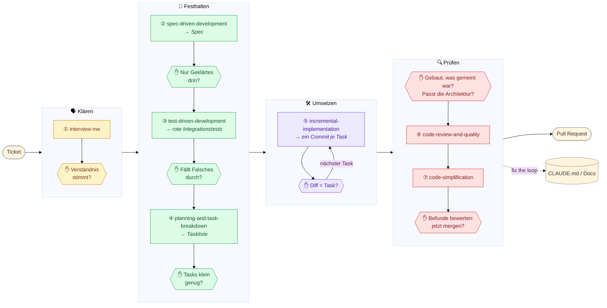

# Agentic SDLC Demo

Demo-Repo für ein 60–90-minütiges Training zum agentic SDLC mit Claude Code:
vom Ticket zum Pull Request, anhand der [agent-skills von Addy
Osmani](https://github.com/addyosmani/agent-skills).

## Inhalt

- [`src/`](src/) / `build.gradle` — Spring Boot REST-Service zur
  Depotverwaltung (Java 21, Gradle 9.5.0). Enthält bereits Lesezugriffe auf
  Depots/Positionen samt Tests; die eigentliche Übungsaufgabe ist noch nicht
  implementiert.
- [`docs/architecture.md`](docs/architecture.md) — Architektur (Onion
  Architecture, `domain`/`app`/`infra`).
- [`ticket.md`](ticket.md) — das Ticket, mit dem die Übung startet.
- [`exercise.md`](exercise.md) — Ablaufplan, Timing und Cheat-Sheet für die
  Session.
- [`GOAL.md`](GOAL.md) — lebendes Dokument, das während der Session
  gemeinsam weitergeschrieben wird (Harness-Verbesserungen, "fix the loop").
- [`.claude/skills/`](.claude/skills/) — die verwendeten agent-skills,
  vorinstalliert in diesem Repo.

## Setup

Voraussetzung: Das Coder-Setup muss bereits durchgeführt sein, inkl. eingerichtetem Java-Proxy (siehe Einladungsmail).
Außerdem nötig: Java 21, Claude Code. Gradle 9.5.0 wird über den Wrapper
(`./gradlew`) automatisch geladen — keine lokale Gradle-Installation nötig.

```bash
./gradlew test
```

Alle Tests sollten grün sein — das ist der Ausgangszustand der Übung.

Öffne anschließend Claude Code im Repo-Root und prüfe mit `/skills`, dass die vendored agent-skills erkannt werden —
`interview-me` sollte in der Liste auftauchen.

## Ablauf

Siehe [`exercise.md`](exercise.md) für den vollständigen Ablaufplan
(interview-me → spec-driven-development → test-driven-development →
planning-and-task-breakdown / incremental-implementation →
code-review-and-quality / code-simplification) inklusive Timing und
Claude-Code-Cheat-Sheet.

## Zielbild: in Phasen arbeiten

So stellen wir uns vor, dass Entwickler mit einem Agent ein Ticket umsetzen: nicht mit einem einzigen Prompt, sondern
in vier Phasen. Jeder Skill liefert ein Artefakt, und jedes Artefakt ist der Maßstab für das nächste: Aus der Spec
werden die Tests, an den Tests misst der Agent seinen Code. Darum prüfst du jedes Artefakt (✋), bevor das nächste
darauf aufbaut. Ein Fehler in der Spec führt sonst zu falschen Tests, die falschen Code grün werden lassen. Bei einem
One-Shot stecken alle Entscheidungen erst im fertigen Code, wo sie am schwersten zu sehen und am teuersten zu ändern
sind.



Fällt bei einer Prüfung eine Lücke auf, geht es zurück in die Phase, in der sie entstanden ist, zum Beispiel von den
Tests zurück zum Klären.

| # | Skill | Artefakt | ✋ Prüffrage an dich | Warum du und nicht der Agent |
|---|---|---|---|---|
| ① | [`interview-me`](.claude/skills/interview-me/) | geklärtes Verständnis im Chat | Kann der Agent in eigenen Worten sagen, was gebaut wird und wann eine Order abgelehnt wird, und meinst du dasselbe? | Was gemeint ist, weißt nur du (bzw. der PO). Lücken im Ticket füllt der Agent sonst still mit Annahmen. |
| ② | [`spec-driven-development`](.claude/skills/spec-driven-development/) | Spec | Steht drin, was ihr geklärt habt, und nichts, was niemand entschieden hat? Sind die technischen Entscheidungen deine? | Die Spec ist der Maßstab für alles Weitere; ein Fehler hier zieht sich durch Tests und Code. Agents ergänzen gern Entscheidungen, die keiner getroffen hat. |
| ③ | [`test-driven-development`](.claude/skills/test-driven-development/) | rote Integrationstests | Gibt es zu jedem Akzeptanzkriterium einen Test, und würde eine falsche Umsetzung durchfallen? Schlagen sie aus dem richtigen Grund fehl? | Der Agent arbeitet, bis die Tests grün sind. Ein zu schwacher Test lässt falschen Code als fertig durchgehen. |
| ④ | [`planning-and-task-breakdown`](.claude/skills/planning-and-task-breakdown/) | Taskliste | Ist jeder Task so klein, dass du seinen Diff in wenigen Minuten verstehst, und ist klar, woran er als fertig gilt? | Der Zuschnitt entscheidet, ob du beim Umsetzen überhaupt noch prüfen kannst. Ein großer Task ist ein versteckter One-Shot. |
| ⑤ | [`incremental-implementation`](.claude/skills/incremental-implementation/) | ein Commit je Task | Macht der Diff genau das, was der Task sagt, nicht mehr und nicht weniger? | Ob das Verhalten stimmt, prüfen die Tests. Beifang und Abweichungen von der Architektur sieht nur, wer den kleinen Diff liest. |
| ⑥ ⑦ | [`code-review-and-quality`](.claude/skills/code-review-and-quality/), [`code-simplification`](.claude/skills/code-simplification/) | Review-Befunde, Refactorings | **Vor den Skills:** Hat der Agent gebaut, was gemeint war, und passt es zur Architektur? **Danach:** Welche Befunde übernimmst du, und würdest du jetzt mergen? | Die Skills finden allgemeine Mängel; ob das Gebaute gemeint war, weißt nur du. Prüf darum zuerst selbst: Wer die Befunde der KI zuerst liest, hakt sie ab, statt selbst hinzusehen. Ihre Befunde sind Vorschläge, entscheiden tust du. Was dem Agent gefehlt hat, kommt in den Harness (`CLAUDE.md`, Docs): fix the loop. |
