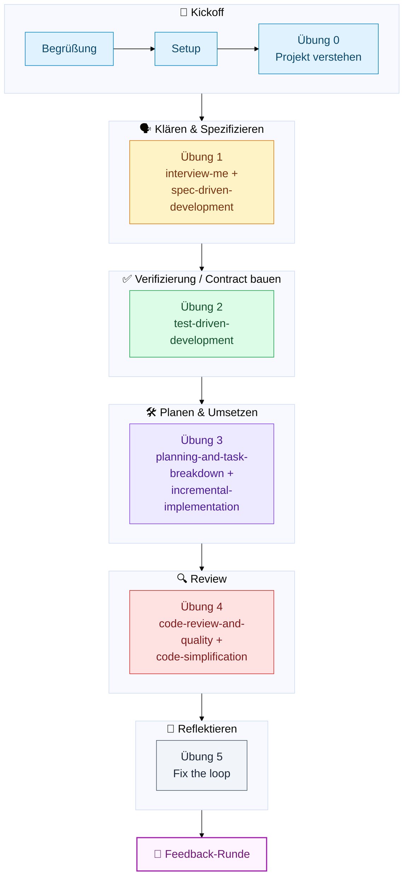

# Exercise: Agentic SDLC mit Claude Code — Ticket → Pull Request

**Dauer:** 60–90 Minuten (Praxis-Teil, nach einer kurzen Theorie-Einheit)
**Repo:** Spring Boot REST-Service zur Depotverwaltung **Ticket:** [`ticket.md`](ticket.md)

## Ziel

Durchlaufe den kompletten Workflow von einem Ticket bis zu einem review-fähigen Pull Request — nicht werkzeug-, sondern
problembasiert: Jeder Schritt löst ein konkretes Problem im Workflow, die Skills sind Mittel zum Zweck.

Die verwendeten [agent-skills](https://github.com/addyosmani/agent-skills)
liegen bereits vendored in [`.claude/skills/`](.claude/skills/) in diesem Repo — es muss nichts installiert werden.

> **Disclaimer:** Das ist ein *opinionated* Workflow, nicht *der* Workflow.
> Es gibt nicht den einen richtigen agentic SDLC. Die hier verwendeten Skills
> sind lediglich eine Sammlung, die typische Aktivitäten im SDLC abbildet —
> andere Zuschnitte, Reihenfolgen oder Skills sind genauso legitim.

## Ablauf

| # | Aktivität                                                    | Ziel                                                                  | ca. Dauer     |
|---|---------------------------------------------------------------|-------------------------------------------------------------------------|---------------|
| – | Begrüßung                                                    | Begrüßung, Erfahrung mit Claude Code abfragen                         | 5 min         |
| – | Setup                                                        | Repo bauen, Tests grün sehen, Claude Code + Skills prüfen             | 5 min         |
| 0 | Projekt verstehen                                            | CLAUDE.md, Code und Architektur kennenlernen, Ticket lesen            | 10 min        |
| 1 | `interview-me` + `spec-driven-development`                   | Unsicherheiten auflösen und Verständnis als Spec fixieren             | 15 min        |
| 2 | `test-driven-development`                                    | Integrationstests definieren, die die Akzeptanzkriterien verifizieren | 10 min        |
| 3 | `planning-and-task-breakdown` + `incremental-implementation` | Arbeit in kleine, unabhängige Schritte zerlegen und umsetzen          | 10 min        |
| 4 | `code-review-and-quality` + `code-simplification`            | Eigenen Code kritisch prüfen, bevor ein PR entsteht                   | 10 min        |
| 5 | Fix the loop                                                 | Gruppendiskussion: Was hat im Harness gefehlt?                        | 10–15 min     |
| – | Feedback-Runde                                               | Rückmeldung zur Übung einsammeln                                      | 5 min         |
|   |                                                               | **Gesamt**                                                            | **80–85 min** |

### Workflow in Phasen



### Begrüßung

Kurze Vorstellungsrunde. Frag ab, wer bereits Erfahrung mit Claude Code hat (noch nie benutzt / schon mal ausprobiert /
regelmäßig im Einsatz) — das bestimmt, wie viel Zeit im Setup für die Cheat-Sheet-Basics eingeplant wird, und auf
welcher Flughöhe das Training stattfindet (eher Einstieg oder eher in die Tiefe).

### Setup

Voraussetzung: Das Coder-Setup muss bereits durchgeführt sein, inkl. eingerichtetem Java-Proxy (siehe Einladungsmail).
Gradle 9.5.0 wird über `./gradlew` automatisch geladen, keine lokale Installation nötig.

```bash
./gradlew test
```

Alle Tests sollten grün sein. Das sind die **harten Tests** — sie beschreiben bestehendes, bereits korrektes Verhalten
und dürfen während der ganzen Übung nicht kaputtgehen.

Öffne anschließend Claude Code im Repo-Root und prüfe mit `/skills`, dass die vendored agent-skills erkannt werden —
`interview-me` sollte in der Liste auftauchen.

**Output:** Lauffähiges Repo.

### Übung 0 — Projekt verstehen

Mach dich mit dem Projekt vertraut, bevor es an das Ticket geht:

- Lies [`CLAUDE.md`](CLAUDE.md).
- Lies den Code — oder lass dir Struktur und Zusammenspiel der Pakete von Claude erklären.
- Lies [`docs/architecture.md`](docs/architecture.md), um die Architektur (Onion Architecture) zu verstehen.
- Lies [`ticket.md`](ticket.md).

### Übung 1 — `/interview-me` + `/spec-driven-development`

Gib Claude das Ticket und starte `/interview-me`. Ziel ist **nicht**, möglichst schnell loszuimplementieren, sondern die
Lücken im Ticket laut auszusprechen:
Was passiert, wenn das Guthaben nicht reicht? Was bei einer Stückzahl von 0 oder negativ? Muss die Order synchron eine
klare Antwort liefern?

> 💡 **Tipp:** Beantworte die Rückfragen so, wie es ein Product Owner /
> fachlicher Ansprechpartner tun würde — auch wenn eine Antwort noch unsicher
> erscheint. Genau diese Unsicherheit soll hier sichtbar werden.

**Output:** Diskussion im Chat bis zum gemeinsamen Verständnis.

Lass anschließend mit `/spec-driven-development` aus dem geklärten Verständnis eine Spec-Datei entstehen (z.B.
`docs/spec-order.md`). Sie sollte am Ende enthalten:

- Finale Akzeptanzkriterien (inkl. der zuvor geklärten Edge Cases)
- Technische Entscheidungen (Endpoint, Request-/Response-Form, Fehlerverhalten)

> 📌 **Hinweis:** Überprüfe die Spec kritisch und iteriere ggf. mit Claude in
> einer Diskussion darüber, bis die Spec die Funktionalität (aka die AKs)
> abdeckt und die technischen Entscheidungen deinen Vorstellungen entsprechen.

**Output:** Spec.

### Übung 2 — `/test-driven-development`

Definiere gemeinsam mit Claude Integrationstests, die die Akzeptanzkriterien der Spec verifizieren — bewusst auf Ebene
der fachlichen Funktionalität (HTTP-Request mit Kauf-Payload rein, Antwort mit Details zur Ausführung raus), nicht auf
Unit-Ebene jeder Methode. Die Tests sollen zunächst fehlschlagen (es gibt ja noch keinen Order-Endpoint).

> 💭 **Idee:** Die Integrationstests sind ein Contract der fachlichen
> Funktionalität (aka. die AKs), an den sich Claude halten muss und an dem er
> stetig seine Implementierung prüfen und Feedback sammeln kann. Das
> reduziert Fehler in der Implementierung. Es lohnt sich hier besonders, Zeit
> zu investieren und die Korrektheit zu prüfen.

**Output:** Integrationstests.

### Übung 3 — `/planning-and-task-breakdown` + `/incremental-implementation`

Plane die Implementierung in kleinen, in sich abgeschlossenen Schritten und setze sie nacheinander um. Führe nach jedem
Schritt die Tests aus. Die bestehenden Tests aus dem Setup müssen durchgehend grün bleiben.

> ℹ️ **Info:** Kleine, unabhängige Schritte stellen sicher, dass der Agent
> nicht an zu großen Schritten scheitert. Außerdem lässt sich die
> Implementierung so in kleine, atomare Commits trennen, die später einfacher
> zu reviewen sind.

**Output:** Kleine, unabhängige Tasks; kleine, atomare Commits zu den Tasks.

### Übung 4 — `/code-review-and-quality` + `/code-simplification`

Lass Claude den eigenen Diff kritisch reviewen und unnötige Komplexität entfernen, bevor ein PR entsteht. Das ist der
Moment, in dem am ehesten auffällt, was am Projekt-Kontext gefehlt hat.

> 💭 **Idee:** Versuche, den Code erst selbst kritisch zu prüfen (ist die
> gebaute Funktionalität korrekt? Gibt es Edge Cases? Wie ist die Struktur
> des Codes, wurde sich an die Architektur gehalten?), bevor du
> den Skill ausführst (vermeidet Bias) — hier aus Zeitgründen nur
> oberflächlich. Versuche zu verstehen, wo der Agent falsch gehandelt hat
> und warum → Übung 5.

**Output:** Review der Implementierung; Refactorings.

### Übung 5 — Fix the loop

Diskussion in der Gruppe: Was hat euer Agent falsch gemacht und wieso? Wie könnte man das in Zukunft verhindern? Wo
würdet ihr den Harness verbessern und wie (als Test, Docs, Skill, ...)?

**Output:** Harness-Verbesserung (z.B. in `CLAUDE.md`).

### Feedback-Runde

Kurze Runde: Was hat funktioniert, was nicht? Was nehmt ihr aus der Übung mit?

## Cheat Sheet: Claude Code Basics

| Befehl        | Zweck                                                                        |
|---------------|------------------------------------------------------------------------------|
| `/model`      | Aktives Modell wechseln                                                      |
| `/usage`      | Token-/Kostenverbrauch der Session anzeigen                                  |
| `/clear`      | Neue Session ohne Verlauf starten                                            |
| `/compact`    | Kontext zusammenfassen, wenn die Session lang wird                           |
| `/resume`     | Eine frühere Session fortsetzen                                              |
| `/subtask`    | Arbeit an einen Subagent delegieren (eigener Kontext)                        |
| `/agents`     | Subagents verwalten / einsehen                                               |
| `/skills`     | Verfügbare Skills auflisten                                                  |
| `/mcp`        | Verbundene MCP-Server einsehen / verwalten                                   |
| `/plugin`     | Plugins (z.B. die agent-skills) installieren / verwalten                     |
| Git Worktrees | Parallel an mehreren Branches/Tasks arbeiten, ohne den Workspace zu wechseln |

## Learnings zum Mitnehmen

- Human-in-the-loop: Rückfragen beantworten, Spec definieren, Tests definieren, kritisches Code Review und Verbesserung
  des Harness
- Unsicherheiten früh klären statt stillschweigend annehmen ist günstiger als später ein falsches Feature zu bauen oder
  endlos mit Claude zu debuggen und zu diskutieren.
- Verifikation (Spec + Tests) **vor** der Implementierung bauen und prüfen:
  funktionaler Contract und technische Entscheidungen, an die sich der Agent hält
- Der Projekt-Harness (`CLAUDE.md`/Docs) ist nie fertig. Jede Lücke, die während der Arbeit auffällt, ist ein Kandidat
  für eine dauerhafte Verbesserung (fix-the-loop!)
- Den eigenen Workflow mit Claude und den Harness stetig reflektieren und aktiv nach Verbesserungen suchen: Claude ist
  ein Multiplikator — ein besserer Workflow bzw. Harness zahlt sich bei jeder zukünftigen Code Änderung aus
